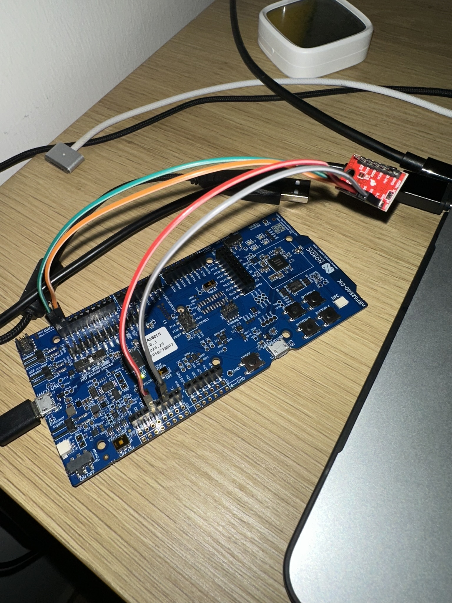

# Embedded experiments

Firmware experiments using the nRF52840 DK and Zephyr. Each experiment records hardware connections, configuration and observed results.

## 01: BME280 over I2C

**Tested 27 October 2026.** SparkFun BME280 connected to the nRF52840 DK over I2C. The Zephyr sample reports temperature, pressure and humidity over serial. Readings responded to hand proximity.



*Test setup. The wiring table below is the reference.*

### Hardware and wiring

Disconnect USB before changing wires. The sensor takes the DK's VDD supply, not its 5 V pin.

| BME280 | nRF52840 DK | Purpose |
| --- | --- | --- |
| GND | GND | Common electrical reference |
| 3.3V | VDD | Sensor power (DK default is approximately 3 V) |
| SDA | P0.26 | I2C data |
| SCL | P0.27 | I2C clock |

USB connects the Mac to the DK's **J2 debugger port**. SW9 is at **VDD**, SW8 at **ON**. The BME280's SPI header is unused.

### Tested configuration

- nRF Connect SDK **v3.4.1**, including Zephyr **4.4.2**.
- Board target **`nrf52840dk/nrf52840`**.
- Nordic's VS Code extensions and SEGGER J-Link **9.82**.
- I2C sensor address **`0x77`**, the SparkFun breakout's default.
- Serial output through **VCOM0**, **115200 baud**, 8 data bits, no parity, 1 stop bit, no flow control.

```text
temp: 19.679992; press: 100.769531; humidity: 53.745117
temp: 19.669982; press: 100.769531; humidity: 53.576171
```

Two lines transcribed from the captured terminal output. Units are degrees C, kPa and percent relative humidity. Around 100.77 kPa is 1007.7 hPa. The decimal places are output formatting, not demonstrated measurement accuracy.

### How the files connect

| File | Role |
| --- | --- |
| [main.c](bme280/src/main.c) | Upstream sample: checks the device, reads and decodes measurements, prints them, then waits one second |
| [app.overlay](bme280/app.overlay) | Application hardware configuration: enables a BME280 at address 0x77 on the DK's I2C controller 0 |
| [prj.conf](bme280/prj.conf) | Enables sensor support and the asynchronous sensor API used by the sample |
| [Kconfig](bme280/Kconfig) | Upstream sample defaults, including bus support and logging |
| [CMakeLists.txt](bme280/CMakeLists.txt) | Finds Zephyr and includes the application's C source in the build |

The board definition already maps I2C0 to P0.26/P0.27. The overlay describes the attached sensor. Zephyr's BME280 driver handles the device registers and calibration calculations. There is no custom sensor driver or AI processing here.

### Reproduce

Install SDK v3.4.1 and its matching toolchain first. In VS Code, open **`bme280/`** as the application, add a build configuration for **`nrf52840dk/nrf52840`**, and build.

For the command-line equivalent, open an **nRF Connect terminal** configured for that SDK/toolchain, then run this from `bme280/`:

```sh
west build -b nrf52840dk/nrf52840 -d build .
```

`west build` coordinates the build; `-b` selects the board, `-d` selects the generated-output directory, and `.` selects this application. This writes build files on the Mac, without programming the DK. The configuration output should say it found `app.overlay`.

With the DK connected, use VS Code's **Flash** action, or:

```sh
west flash -d build
```

Flashing replaces the firmware on the selected board. For this command, connect only the intended DK. Open VCOM0 at 115200 baud to read measurements. Press RESET to restart the program if needed. Build and flash were performed through VS Code; these commands describe the equivalent operations.

### Integration notes

- Use the exact board target: `nrf52840dk/nrf52840`. The nrf21540dk target describes different board hardware despite using the same MCU.
- The devicetree overlay must match the physical wiring and sensor address.
- A separate USB dongle initially received no power through a Mac adapter connection. Unpowered continuity checks passed, and reversing the USB-C orientation restored operation. The exact adapter/contact/port fault was not isolated. The dongle is not required for this experiment.

**Verified:** firmware build/flash, serial output, plausible sensor readings and response to hand proximity. **Not yet tested:** calibrated sensor accuracy, wireless communication, power consumption or logic-analyzer captures.

### Attribution

The application is based on the [Zephyr BME280 sample distributed with nRF Connect SDK v3.4.1](https://github.com/nrfconnect/sdk-zephyr/tree/ncs-v3.4.1/samples/sensor/bme280). The C source, CMake file, Kconfig and initial project configuration come from that sample; their original notices are retained. Project-specific work comprises hardware hookup, the application overlay, build/flash setup, troubleshooting and documentation. Setup photograph by Farzam Daghighi. Code is provided under [Apache-2.0](LICENSE).
